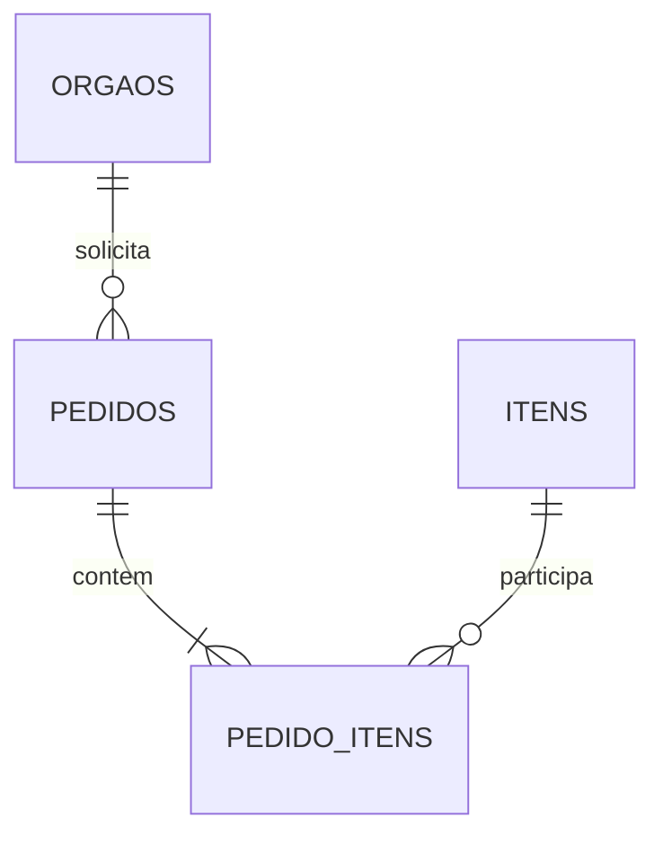

# controle-estoque-institucional

Sistema de controle de estoque com backend em Java 17/Spring Boot 2.7.18 e frontend em Vue 2/Vuetify 2.

Projeto Maven: `br.com.estoque:controle-estoque-institucional`.
Pacote Java: `br.com.estoque`.
Repositório: https://github.com/Matheuscp1/controle-estoque-institucional

## Estrutura

Cache de consultas compartilhado com Redis e logs de requisições/importação: veja [configuração e limites](docs/cache-logs.md).

Documentação interativa da API: [Swagger UI](http://localhost:8080/swagger-ui.html). Consulte [o guia de uso](docs/swagger.md) para exemplos, upload do ZIP e revisão das ocorrências.

As listagens `GET /api/itens` e `GET /api/orgaos/{codigo}/pedidos` retornam `{ "registros": [...], "total": 123 }`. No frontend, leia a página em `registros` e a quantidade correspondente aos filtros em `total`; o cursor e o limite não reduzem esse total. A lista de órgãos mantém o formato de array.

- `pom.xml`: dependências e build Maven.
- `src/main/java/br/com/estoque/Application.java`: entrada da aplicação.
- `src/main/resources/application.yml`: configuração do banco e da API.
- `Dockerfile`, `frontend/Dockerfile` e `compose.yaml`: backend, frontend, PostgreSQL 15, RabbitMQ e Redis.

## Executar

Execute os comandos na raiz do projeto, com Docker Engine/Desktop e Docker Compose v2 disponíveis. Para executar pela IDE ou Maven, também são necessários JDK 17 ou superior e Maven 3.9. O build Docker fornece seu próprio JDK e Maven.

```sh
docker compose up --build
```

Abra o frontend em `http://localhost:8081`. O Nginx encaminha `/api` para o backend pela rede do Compose; a API e o Swagger também ficam disponíveis em `http://localhost:8080`. O Flyway aplica as migrações automaticamente.
No Compose, a importação inicial está habilitada: consultas mostram os dados inseridos progressivamente, enquanto alterações retornam `503` até a primeira validação. Envie o ZIP pelo endpoint de importação seguindo [o guia de carga histórica](docs/importacao.md).
O banco usa volume persistente. A senha padrão é apenas para desenvolvimento; configure `DB_PASSWORD` em `.env` para alterá-la.

Confira os serviços com `docker compose ps` e acompanhe a API com `docker compose logs -f backend`. A documentação fica em [Swagger UI](http://localhost:8080/swagger-ui.html), e o contrato JSON em [OpenAPI](http://localhost:8080/v3/api-docs). O primeiro build depende do download das imagens e dependências.

### Executar a carga histórica

A carga começa por upload; iniciar a aplicação não lê o ZIP automaticamente. Disponibilize `massa-dados/massa-dados-candidato.zip` localmente e envie para uma instalação com tabelas operacionais vazias:

```sh
curl -X POST http://localhost:8080/api/imports -F "file=@massa-dados/massa-dados-candidato.zip"
curl http://localhost:8080/api/imports/active
```

No PowerShell, use `curl.exe` nos dois comandos. Também é possível enviar o arquivo pelo Swagger. O upload retorna `202` com o ID, sem esperar o processamento. `/active` retorna a carga atual e seus contadores, ou `204` se ainda não houver carga. Para consultar as ocorrências, use `GET /api/imports/{id}/issues`.

#### Passo a passo pelo Swagger

1. Com o backend iniciado, abra [Swagger UI](http://localhost:8080/swagger-ui.html) e localize o grupo **Importação**.
2. Expanda **`POST /api/imports`** e clique em **Try it out**.
3. No campo **file**, clique em **Choose File / Escolher arquivo** e selecione `massa-dados-candidato.zip`. Envie o ZIP sem descompactar, com `orgaos.csv`, `itens.csv`, `pedidos.csv` e `pedido_itens.csv` na raiz. O limite é 128 MiB.
4. Clique em **Execute**. Em **Server response**, confira o código **202** e copie o `id` do **Response body**. Isso confirma o recebimento; o processamento continua em segundo plano.
5. Expanda **`GET /api/imports/active`**, clique em **Try it out** e depois em **Execute**. Essa rota descobre a carga atual sem exigir o ID. Alternativamente, use **`GET /api/imports/{id}`**, preenchendo `id` com o valor copiado, sem aspas.
6. Execute a consulta novamente para atualizar o progresso: o Swagger não faz atualização automática. Observe `status`, `completedBatches`, `totalBatches`, `publishedItems` e `publishedOrders`. Durante `PREPARING`, o total ainda pode ser zero. Todos os lotes concluídos não significam que a validação final terminou.
7. Aguarde **`COMPLETED`** ou **`COMPLETED_WITH_ISSUES`**. No segundo caso, siga as rotas de revisão abaixo. Se ocorrer **`FAILED`**, confira `error` e os logs antes de usar `/retry`.

Consultas mostram os registros já publicados durante a importação. Criação, edição e cancelamento aguardam a primeira validação. Ao terminar em `COMPLETED_WITH_ISSUES`, os registros consistentes ficam disponíveis para operação, enquanto os afetados permanecem protegidos até revisão. Reenviar o mesmo ZIP retorna a carga existente, sem duplicá-la.

#### Consultar e corrigir inconsistências

No Swagger, os parâmetros são preenchidos nos campos da operação após **Try it out**. Use o ID retornado pelo upload ou por `/active`. As correções alteram as linhas preservadas da importação; não use os endpoints operacionais de itens/pedidos para contornar a quarentena.

| Ordem | Rota | Como usar |
| --- | --- | --- |
| 1 | `GET /api/imports/{id}/issues` | Informe `after=0`, `limit=100` e `history=false`. Confira `arquivo`, `linha`, `chave`, `motivo` e `revision`. Na próxima página, use o último `id` de ocorrência como `after`, não o ID da carga. |
| 2 | `GET /api/imports/{id}/rows` | Informe `source` com o nome do CSV, `key` com a chave do registro, `after=0` e `limit=100`. Consulte todas as linhas envolvidas, inclusive duplicatas. Para paginar, use a última `line` retornada. |
| 3 | `PUT /api/imports/{id}/rows/{source}/{line}` | Corrija uma linha existente, enviando todos os campos CSV em `fields`, a `revision` atual e uma `justification`. Não altere o identificador. Retorna `200` com a nova revisão. |
| 4 | `POST /api/imports/{id}/reprocess` | Após revisar e salvar as correções, execute sem corpo. Retorna `202` e agenda a revalidação, sem reenviar o ZIP. |
| 5 | `GET /api/imports/{id}` | Acompanhe `REVIEW_PENDING` até a conclusão. Consulte `/issues` novamente para verificar as pendências restantes. |

Exemplo de corpo para corrigir uma linha de `itens.csv`. Substitua os valores pelos dados conferidos na origem; o saldo abaixo é apenas ilustrativo, não uma correção automática para `BALANCE_MISMATCH`:

```json
{
  "revision": 0,
  "justification": "Saldo conferido com o histórico de pedidos",
  "fields": {
    "codigo": "A",
    "descricao": "Papel",
    "unidade": "UN",
    "saldo_inicial": "10",
    "saldo_atual": "7",
    "ativo": "S",
    "data_cadastro": "2020-01-01"
  }
}
```

Use `source=itens.csv` e a `line` real consultada em `/rows`. Os campos `original` e `fields` das consultas vêm como texto JSON; no corpo da correção, `fields` é um **objeto JSON**, como acima. A revisão não é sempre zero: copie o valor atual. Se receber `409`, releia a linha e confira se houve alteração concorrente, reprocessamento em andamento ou restrição sobre dados já liberados.

Outras rotas úteis na revisão:

| Rota | Quando usar |
| --- | --- |
| `GET /api/imports/{id}/quarantine` | Consultar registros protegidos. Informe `type=ITEM`, `ORDER` ou `ORGANIZATION`, `limit=100` e deixe `after` vazio na primeira página; depois use a última `key`. |
| `POST /api/imports/{id}/rows/{source}` | Adicionar cadastro, cabeçalho ou linha ausente dentro do escopo de revisão. Envie os campos completos, `revision=0` e justificativa. Retorna `201`; não é um cadastro operacional genérico. |
| `POST /api/imports/{id}/rows/{source}/{line}/exclude-duplicate` | Desconsiderar somente uma cópia idêntica, preservando outra válida. Envie `revision` atual e `justification`; retorna `204`. Não permite remover uma linha diferente para aceitar um pedido parcial. |
| `GET /api/imports/{id}/corrections` | Consultar o histórico das correções com `after=0` e `limit=100`; use o último `id` retornado para paginar. |
| `POST /api/imports/{id}/retry` | Retomar uma falha técnica da carga após corrigir sua causa. Para validar dados corrigidos, use `/reprocess`. |

Para `UNKNOWN_ITEM` ou `UNKNOWN_ORDER`, confira a referência e o cadastro/cabeçalho correspondente; inclua dados ausentes somente após confirmação na origem. Para `EMPTY_ORDER`, confira as linhas que faltam ou foram rejeitadas. Para `BALANCE_MISMATCH`, reconcilie saldo e histórico antes de alterar valores. Não existe uma rota para apenas marcar uma ocorrência como resolvida: salvar uma correção não a resolve imediatamente, pois a conclusão depende da revalidação.

Durante `REVIEW_PENDING`, novas correções ficam bloqueadas. O original e o histórico de alterações são preservados. Veja [as regras completas da revisão](docs/revisao-importacao.md) e [o guia do Swagger](docs/swagger.md).

A massa contém **3.382.295 registros**, distribuídos em **6.766 lotes de até 500 linhas**. Na execução local de 19/11/2026, o upload levou 7,69 s e o processamento até a conclusão levou aproximadamente **1h02min19s**. Essa referência é anterior à publicação agrupada de até oito lotes por transação; o ganho da nova versão ainda não foi medido na massa completa. Tamanhos dos batches, resultados e instruções de revisão estão no [guia de importação](docs/importacao.md).

Para parar os serviços, use `docker compose down`, preservando os volumes. Não use `down -v` para repetir a carga sobre uma base com dados que precisam ser mantidos.

Para compilar com Java 17 e Maven:

```sh
mvn package
```

O build da imagem compila e empacota somente o código de produção, sem executar os testes. Execute `mvn test` antes de entregar: os testes de integração precisam do Docker disponível na máquina, fora do build da imagem. O processo do container usa UID/GID `10001`, com escrita habilitada em `/app/logs` e `/data/imports`. Volumes novos de importação herdam essas permissões. Volumes existentes ou diretórios montados manualmente precisam permitir escrita para esse usuário; não remova volumes com dados para corrigir permissões.

Para executar a API pela IDE/Maven com os serviços locais, use `docker compose up -d db rabbitmq redis` e depois `mvn spring-boot:run`. Com serviços externos, configure `DB_URL`, `DB_USER`, `DB_PASSWORD`, `RABBIT_HOST`, `RABBIT_USER`, `RABBIT_PASSWORD` e `REDIS_HOST`. O cache pode ser desativado com `READ_CACHE_ENABLED=false`; a carga histórica exige RabbitMQ. Consulte [as opções de cache](docs/cache-logs.md) e [as opções de importação](docs/importacao.md).

## Modelo de dados



| Tabela | Papel no modelo |
| --- | --- |
| `orgaos` | Cadastro identificado por código único, com sigla, nome e UF. |
| `itens` | Catálogo com código único, descrição, unidade, saldo, situação e versão para edição concorrente. |
| `pedidos` | Cabeçalho associado a um órgão, com identificador externo único, assinatura do conteúdo, situação e datas. |
| `pedido_itens` | Associação entre pedido e item, com quantidade e chave composta que impede repetição do item no pedido. |

O saldo atual é armazenado no item para evitar recalcular o histórico em cada consulta; débitos e devoluções exigem transações. Quantidades usam `NUMERIC(19,3)`, sem ponto flutuante. Códigos são textuais para preservar zeros à esquerda. O ID interno do pedido é numérico; o externo identifica reenvios da integração.

A importação tem tabelas próprias para controle da carga, lotes, linhas originais, manifesto de completude, ocorrências, quarentena e auditoria das correções. Elas preservam o legado sem tratar automaticamente todo registro recebido como válido. As relações, restrições e justificativas estão em [modelagem](docs/modelagem.md).

## Principais decisões e motivos

| Decisão | Motivo e custo assumido |
| --- | --- |
| Monólito modular | Manter uma única aplicação e transações locais entre estoque e pedidos. A separação em camadas acrescenta classes, mas permite testar as regras isoladamente. |
| PostgreSQL, JPA e Flyway | Usar transações e restrições no banco, mapeamentos na infraestrutura e evolução versionada do esquema. A importação também usa SQL em conjunto onde carregar entidades individualmente seria caro. |
| RabbitMQ apenas na carga | Desacoplar leitura e consumo, limitar concorrência e retomar lotes após falhas. A fila acrescenta operação e reentregas; não garante, sozinha, inserts mais rápidos. Pedidos online continuam síncronos e transacionais. |
| Publicação incremental | Disponibilizar consultas antes do fim da carga, mantendo pedidos completos e bloqueando alterações até a validação inicial. |
| Redis para consultas | Compartilhar respostas com TTL curto. O custo é consistência eventual nas leituras; reserva, cancelamento e controle de versão sempre consultam PostgreSQL. |
| Testes unitários e de integração | Testar regras isoladas e verificar concorrência e rollback com PostgreSQL real. H2 ajuda nos testes pequenos, mas não substitui essa validação. |

## Como as regras de negócio são garantidas

| Regra do enunciado | Garantia implementada |
| --- | --- |
| Código único e saldo nunca negativo | Chaves e restrições SQL, validação de domínio e conferência de saldo dentro da transação. |
| Pedido com um ou mais itens, atendido por inteiro | Validação das linhas e transação única para cabeçalho, linhas e débitos; qualquer falha desfaz a operação. No legado, o manifesto exige todas as linhas esperadas. |
| Cancelamento devolve as quantidades uma única vez | Bloqueio do pedido, conferência da situação e devolução transacional. Uma segunda tentativa recebe conflito. |
| Pedidos simultâneos dos mesmos itens | Bloqueio pessimista dos itens em ordem de código e verificação do saldo sob o bloqueio. |
| Edições simultâneas sem perda silenciosa | Versão enviada pelo cliente e `@Version`; edição desatualizada recebe conflito, inclusive após uma movimentação de saldo. |
| Reenvio da mesma requisição sem duplicar pedido | Identificador externo único e assinatura do conteúdo. Conteúdo equivalente retorna o pedido existente; conteúdo diferente recebe conflito. |

Os testes cobrem reserva concorrente, reenvios simultâneos, rollback, edição desatualizada e cancelamento concorrente. No importador, verificam completude, reentregas, publicação concorrente, ocorrências e revisão. A descrição das garantias não significa que todas as combinações possíveis de falhas foram testadas.

## Premissas adotadas

- Códigos de itens e órgãos são estáveis e não editáveis. O identificador externo do pedido é único em todo o sistema, não apenas dentro de um órgão.
- Quantidades aceitam até três casas decimais. Um pedido não pode repetir o mesmo item em linhas diferentes.
- Item inativo não recebe novos pedidos, mas pode aparecer no histórico e receber devolução de cancelamento.
- Datas legadas sem fuso usam `America/Sao_Paulo`. Na reconstrução do saldo, reservas precedem devoluções quando os eventos têm o mesmo instante.
- Motivo de cancelamento ausente é aceito no legado; data válida continua obrigatória. Novos cancelamentos pela API exigem motivo.
- A carga inicial exige base operacional vazia. As ocorrências podem ser tratadas depois da conclusão, sem liberar movimentações sobre os registros afetados.
- Os saldos históricos são copiados e reconciliados, sem descontar novamente os pedidos importados. Divergências não são corrigidas silenciosamente.

## Arquitetura e API

Adotamos um **monólito modular com arquitetura de portas e adaptadores (hexagonal)**. Uma única aplicação é organizada por funcionalidades, como itens, órgãos e pedidos. Dentro de cada módulo, as regras dependem de interfaces, enquanto os detalhes de HTTP e persistência ficam nos adaptadores externos. Os módulos `items`, `organizations` e `orders` seguem essa organização. O módulo `imports` acrescenta validação do legado, processamento assíncrono, inserts incrementais, conclusão com pendências e revisão manual.

| Camada | Responsabilidade |
| --- | --- |
| `domain` | Objetos e regras de negócio, independentes de Spring e JPA. |
| `application` | Casos de uso e interfaces de repositório, que representam as portas de saída. |
| `api` | Adaptador de entrada HTTP: endpoints, requisições, respostas e tradução de erros. |
| `infrastructure` | Adaptadores de persistência, entidades JPA e configuração dos componentes. |

Consulte [a arquitetura e o ciclo TDD](docs/arquitetura.md) e [os contratos da API de itens](docs/api-itens.md).

O módulo `organizations` oferece cadastro e consulta paginada de órgãos, validação de UF e proteção contra códigos duplicados. Consulte [os contratos da API de órgãos](docs/api-organizations.md).

O módulo `orders` oferece criação e consulta de pedidos, listagem por órgão e cancelamento. `OrderEntity` e `OrderItemEntity` representam o cabeçalho e suas linhas em JPA, com chave composta para impedir itens repetidos. Consulte [os contratos, exemplos e premissas da API de pedidos](docs/api-orders.md).

Pedidos reservam todo o saldo em uma única transação. Os itens são bloqueados em ordem de código e suas versões avançam a cada movimentação. O identificador externo é único globalmente: reenvios equivalentes retornam o pedido existente; conteúdos diferentes recebem conflito. O cancelamento bloqueia o pedido e devolve as quantidades somente uma vez, inclusive para itens posteriormente inativados. Uma falha desfaz a operação inteira.

A persistência usa Spring Data JPA, com `@Entity` e `@Version` na infraestrutura. O domínio permanece independente do JPA. As migrações são gerenciadas pelo Flyway; o Hibernate valida o esquema existente.

O módulo de itens oferece cadastro, consulta, edição, inativação lógica, filtros e paginação. A unidade é normalizada para maiúsculas, e edições exigem a versão atual do item.

### Vantagens e custos dessa organização

A principal vantagem é testar e alterar as regras sem depender do Spring ou do banco. Nos testes unitários, os casos de uso recebem repositórios simulados e um relógio fixo. Nos testes de integração, os adaptadores são verificados com a persistência real do ambiente de teste.

A separação também reduz o impacto de mudanças técnicas. Neste projeto, a persistência de itens foi trocada de JDBC para JPA mantendo a interface do repositório e os casos de uso. As responsabilidades ficam localizadas: alterações no contrato HTTP pertencem à API; alterações no mapeamento do banco pertencem à infraestrutura.

Manter uma única aplicação simplifica a execução pelo Docker Compose e permite transações locais entre pedidos e estoque. A arquitetura, por si só, não garante atomicidade nem protege contra concorrência: essas regras continuam exigindo transações, controle de versão, bloqueios quando necessários e testes.

O custo é ter mais classes e conversões entre objetos de domínio e entidades persistentes. Para este desafio, essa separação ajuda a isolar e testar as regras de saldo, pedidos e importação. Criamos interfaces nos limites de dependência, sem exigir uma interface para toda classe.

**SOLID** orienta a distribuição de responsabilidades e dependências entre as classes. **TDD** orienta o desenvolvimento por testes escritos antes da implementação. São práticas utilizadas no projeto, não nomes da arquitetura.

### Configuração dos módulos e da persistência

Cada módulo possui sua configuração na camada `infrastructure`, responsável por conectar os casos de uso e a persistência ao Spring. A configuração agrupa os componentes do módulo; não é necessário criar uma classe de configuração para cada entidade.

- `@Configuration` identifica a classe de configuração.
- `@EntityScan` informa os pacotes das entidades JPA.
- `@EnableJpaRepositories` informa o pacote dos repositórios Spring Data.
- `@Bean` cria os serviços de aplicação, fornecendo as implementações das interfaces de repositório e outras dependências necessárias, como um relógio para obter datas.

Essa composição mantém os serviços de aplicação como classes Java comuns, sem `@Service` ou dependências do Spring. Os serviços dependem de interfaces de repositório, e não do JPA. Nos testes unitários, podemos construí-los diretamente com repositórios simulados e, quando necessário, um relógio fixo, sem iniciar a aplicação.

Na estrutura atual, a aplicação principal poderia descobrir entidades e repositórios automaticamente por estarem abaixo de `br.com.estoque`. A busca explícita torna os limites dos módulos claros e permite carregar sua persistência nos testes isolados. Conforme novos módulos forem implementados, suas configurações deverão incluir os respectivos pacotes de entidades e repositórios.

## Banco e testes

As migrações criam `orgaos`, `itens`, `pedidos` e `pedido_itens`, com restrições e índices. Veja [a modelagem detalhada](docs/modelagem.md).

```sh
mvn test
```

Os testes unitários de domínio e aplicação executam sem Spring. Os testes de API e de integridade usam H2 no modo PostgreSQL. A suíte de pedidos também executa com PostgreSQL 15 real via Testcontainers, incluindo reserva concorrente, reenvios simultâneos, rollback integral e cancelamento concorrente. Essa suíte exige Docker em execução e pode baixar a imagem na primeira execução.

Para executar apenas a suíte de pedidos no PostgreSQL:

```sh
mvn "-Dtest=OrdersPostgresTest" test
```

Para executar os testes sem Docker, excluindo explicitamente a suíte PostgreSQL:

```sh
mvn "-Dtest=*,!OrdersPostgresTest,!ImportQueueIntegrationTest" test
```

Os testes pequenos verificam regras e concorrência funcional. Em 19/11/2026, a massa completa terminou em `COMPLETED_WITH_ISSUES` em aproximadamente 1h02min19s no ambiente local. Essa medição é anterior à otimização que publica até oito lotes por transação e evita recalcular pedidos já inseridos; o ganho dessa alteração ainda não foi medido na massa completa. Os resultados e limites estão no [guia de importação](docs/importacao.md).

## Tratamento dos dados legados

**Estado atual:** o importador realiza inserts incrementais. As consultas mostram os dados já inseridos durante a carga, com `X-Import-Ready: false`; alterações aguardam a primeira validação. A carga conclui em `COMPLETED` ou `COMPLETED_WITH_ISSUES`, liberando o uso dos dados consistentes e protegendo os afetados até revisão. Há endpoints para consultar ocorrências, corrigir linhas com revisão e justificativa, adicionar registros ausentes, desconsiderar duplicatas idênticas e agendar reprocessamento. Consulte [a revisão manual](docs/revisao-importacao.md) e [a execução da carga](docs/importacao.md).

Foram lidos 250 órgãos, 50.000 itens, 1.002.000 cabeçalhos de pedidos e 2.330.045 linhas de pedidos. A auditoria identificou 2.000 cabeçalhos extras idênticos, referências inexistentes, quantidades inválidas, 100 pedidos sem linhas e cancelamentos incompletos. Os números e suas limitações estão na [análise da massa](docs/analise-massa.md).

A importação deve respeitar as mesmas regras de negócio da operação online: saldo não negativo, pedido completo, identificador único e cancelamento sem devolução duplicada. A origem legada não autoriza inserir registros inválidos nas tabelas definitivas.

| Situação | Tratamento |
| --- | --- |
| Cabeçalhos equivalentes após normalização com o mesmo identificador | Consolidar em uma ocorrência e contabilizar as duplicatas na carga concluída. |
| Mesmo identificador com conteúdos diferentes | Separar o pedido para análise, sem sobrescrever nenhuma ocorrência. |
| Pedido sem linhas, com referência inexistente ou quantidade inválida | Rejeitar o pedido inteiro da carga definitiva, preservando os registros de origem para análise. |
| Par pedido/item repetido | Separar o pedido até definir se é duplicação ou quantidade complementar; não somar nem descartar linhas silenciosamente. |
| Unidade com variação de caixa ou espaços | Normalizar com remoção dos espaços nas extremidades e conversão para maiúsculas, registrando a transformação. |
| Cancelamento sem data válida ou anterior à criação | Separar para análise; não inventar a data. O motivo é opcional no legado e sua ausência, sozinha, não gera ocorrência. |
| Pedido histórico de item atualmente inativo | Preservar se válido: a inatividade atual não comprova que o item estava inativo na data do pedido. |
| Divergência de saldo | Registrar e reconciliar após o saneamento; não corrigir silenciosamente nem descontar o histórico novamente sobre `saldo_atual`. |

Os registros permanecem em `import_rows`, fora das tabelas operacionais, com arquivo de origem, linha lógica, identificador e conteúdo original. `import_issues` registra as inconsistências e pode ser consultada pela API com paginação. O ZIP original também é preservado.

**Os inserts são incrementais; pendências não impedem concluir o processamento.** Itens com saldo ou histórico pendente não podem ser movimentados nem editados, e pedidos afetados não podem ser cancelados ou ter seu identificador reutilizado. As correções preservam o original, exigem revisão e justificativa e só são publicadas após revalidação. Dados e movimentos já liberados não são sobrescritos pelo histórico. Reenviar exatamente o mesmo ZIP retorna a carga existente; o reprocessamento manual não precisa reler o arquivo.

A carga usa Java, leitura em fluxo, lotes de 500 registros e gravações JPA em batches de 50. As datas sem offset usam `America/Sao_Paulo`; horários ambíguos ou inexistentes são rejeitados. A validação global verifica o saldo final e reconstrói reservas e devoluções para detectar saldos históricos negativos. As 2.824 divergências da auditoria inicial são comparações brutas, anteriores ao saneamento, e não valores prontos para corrigir o banco. A publicação copia os saldos históricos sem executar novos débitos.


## Limitações e o que faria com mais tempo

O foco desta entrega foi garantir consistência dos pedidos e permitir importar e revisar o histórico. O Compose reúne backend e frontend, mas ainda falta medir a experiência integrada sob carga real de usuários.

Com mais tempo, as prioridades seriam:

1. Medir consultas e filtros com a base completa, incluindo o custo dos totais paginados, e ajustar índices conforme os planos de execução. Ainda não há um benchmark que comprove os tempos de resposta em tela sob carga.
2. Reexecutar a massa com a publicação agrupada e medir separadamente manifesto, consumo, publicação e validação. O tempo registrado para a versão anterior não comprova o ganho da otimização.
3. Revisar as ocorrências com o responsável pelos dados e validar as correções. Não inventar dados para eliminar pendências.
4. Acrescentar um histórico de movimentações para auditar ajustes manuais de saldo. A auditoria de correções do legado já existe, mas não substitui esse histórico operacional.

Autenticação e autorização por órgão/perfil não foram implementadas; o sistema não identifica gestores e solicitantes por uma sessão autenticada. Isso deve ser definido antes de uso real. O bloqueio durante a importação e as restrições de quarentena protegem consistência, não representam controle de acesso de usuários.

## Uso de IA

Foi utilizado o **Codex, da OpenAI**, como assistente de desenvolvimento. O apoio incluiu interpretação das regras, propostas de modelagem e arquitetura, implementação de código e testes, análise de consultas SQL, investigação da importação e redação da documentação. Portanto, o uso não ficou limitado a sugestões de texto: partes do código e dos testes foram produzidas com assistência de IA.

O trabalho foi conduzido de forma iterativa: o responsável pelo projeto definiu prioridades, pediu explicações, ajustou decisões e autorizou commits e publicações. As sugestões foram confrontadas com as regras do enunciado, testes automatizados e execuções locais. Exemplos concretos de sugestões rejeitadas ou corrigidas:

| Proposta ou implementação inicial | Decisão adotada e motivo |
| --- | --- |
| Persistência inicial de itens com JDBC puro | Foi solicitada a adoção de JPA com `@Entity`, mantendo domínio e casos de uso separados da persistência. SQL específico foi mantido no processamento em volume. |
| Importação sem RabbitMQ | Foi escolhida uma fila para controlar consumo e retomada dos lotes. A decisão não foi tratada como prova de ganho de velocidade; o desempenho depende de medição. |
| Tratar cancelamento legado sem motivo como ocorrência | A regra foi corrigida: o motivo não é obrigatório no histórico. Os demais requisitos de cancelamento continuam sendo validados. |
| Manter a carga bloqueada enquanto existissem ocorrências | Foi adotado `COMPLETED_WITH_ISSUES`, liberando dados consistentes e mantendo proteção individual sobre os afetados. |
| Esperar toda a carga para disponibilizar os dados | A publicação passou a ser incremental para permitir consultas durante o processamento, sem liberar alterações antes da validação inicial. |

As respostas da IA não foram consideradas evidência suficiente de correção ou desempenho. A validação incluiu testes de domínio, API, banco, concorrência e importação, além da execução da massa histórica. Isso não elimina limitações: a otimização mais recente ainda não foi medida na massa completa, e o desempenho das consultas sob carga permanece como trabalho futuro. As decisões e seus motivos estão documentados para que possam ser explicados e revisados por quem entrega o projeto.


# Estoque Institucional — front-end

Interface em Vue 2 e Vuetify 2 para o desafio de controle de saldo de itens e pedidos de órgãos públicos.
Typescript para tipagem e melhor desenvolvimento

## Executar

No desenvolvimento local, o backend precisa estar disponível em `http://localhost:8080`. Seu código está na pasta `src` deste repositório.

Com Node.js 22:

```sh
cd frontend
npm ci
npm run dev
```

O Vite mostra a URL local. Para usar outra API, configure `API_TARGET` antes de iniciar o servidor.

Com Docker, execute na raiz do repositório:

```sh
docker compose up --build
```

A interface fica em `http://localhost:8081`. O Nginx encaminha `/api` para `backend:8080` na rede interna. Para outro endereço acessível ao contêiner, configure `API_UPSTREAM` no serviço `frontend` do Compose.

## Testes e TDD

No diretório `frontend`, execute `npm test` para os testes unitários e de componentes, ou `npm run test:watch` durante o desenvolvimento. O ciclo de TDD é: escrever um teste para o comportamento esperado, confirmar que falha, implementar a alteração e executar novamente os testes e `npm run typecheck`.

Os testes cobrem valores decimais, contrato HTTP, paginação com cancelamento de requisições, edição de item e cancelamento de pedido. As chamadas à API são simuladas; esses testes não dependem do back-end em execução.

## Organização do código

`frontend/src/views/items` e `frontend/src/views/orders` contêm as telas e seus componentes específicos. `frontend/src/components` reúne componentes usados por mais de uma tela; `services` concentra o acesso à API; `utils` guarda funções sem dependência da interface. Os testes ficam ao lado dos arquivos testados.

## Funcionalidades

- Consulta de itens por descrição, unidade e faixa de saldo, com paginação por cursor e total correspondente aos filtros.
- Edição de descrição, unidade, saldo e situação, com controle de versão. Um conflito exige recarregar e revisar os dados.
- Consulta de pedidos de um órgão por período e situação, com itens, quantidades e total de pedidos correspondente aos filtros.
- Cancelamento de pedido confirmado com motivo e atualização da lista.

Durante a carga inicial, o cabeçalho `X-Import-Ready: false` faz a interface mostrar um aviso de dados parciais e desabilitar edição e cancelamento. O painel consulta `GET /api/imports/active` automaticamente a cada cinco segundos para mostrar a etapa, os lotes e os registros publicados; `204` indica que nenhuma carga foi registrada. O tempo exibido começa quando o job é visto no navegador, pois a API ainda não informa seu horário inicial. O percentual descreve somente o processamento dos lotes, sem previsão de término da validação.

As datas de filtro abrangem os dias selecionados no fuso do navegador. O cliente conserva a precisão decimal dos saldos permitidos pela API. A tela informa erros, listas vazias e o bloqueio HTTP 503 da carga inicial.

O histórico de implementação por etapa está no [roadmap](docs/roadmap-frontend.md).

## Uso de IA

O Codex cruzou o enunciado com os contratos da API, para melhor desempenho com teste

## Tela inicial

