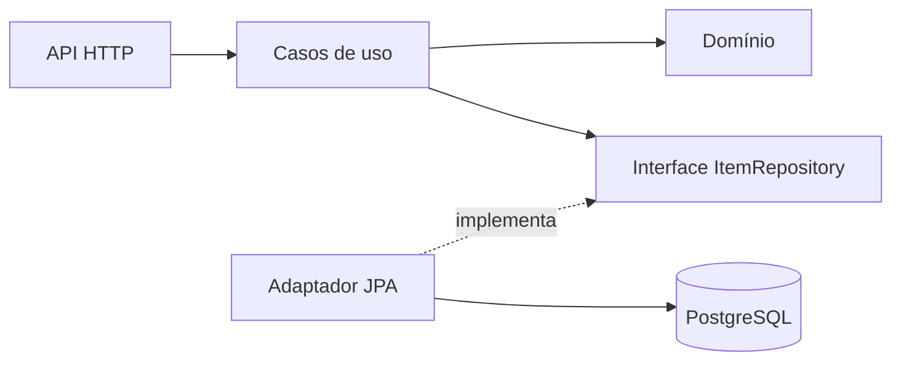

# Arquitetura do backend

## Decisão

Monólito modular: uma aplicação Spring Boot, um PostgreSQL e módulos organizados por funcionalidade. Os módulos de itens, órgãos e pedidos estão implementados; a importação seguirá a mesma organização.

Essa estrutura permite manter transações locais entre pedidos e estoque, necessárias para o atendimento integral, e subir o backend com um único serviço. O desafio não exige deploy ou escala independentes por funcionalidade, portanto microsserviços acrescentariam comunicação e coordenação de transações sem uma necessidade demonstrada.

Dentro de cada módulo usamos camadas com inversão de dependência, seguindo a ideia de portas e adaptadores. Não há interfaces para todas as classes: elas são usadas nos limites que precisam de uma implementação externa, como a persistência.

```text
br.com.estoque
└── items
    ├── domain          Item e suas regras; erros sem códigos HTTP
    ├── application     ItemService, filtros e interface ItemRepository
    ├── api             Controller, requests, responses e tradução de erros
    └── infrastructure  ItemEntity, Spring Data JPA e configuração dos componentes
```



O domínio não importa Spring, JPA ou classes da API. A aplicação recebe o repositório e o relógio por construtor. A infraestrutura conecta as implementações. A API usa DTOs próprios, sem expor entidades persistentes ou mapas genéricos.

`ItemEntity` mapeia a tabela `itens` com `@Entity`, `@Table`, `@Id` e `@Version`. A entidade fica na infraestrutura, separada do `Item` imutável do domínio. Isso preserva as regras sem depender do ciclo de vida do Hibernate. `SpringDataItemRepository` estende `JpaRepository`; `JpaItemRepository` implementa a interface da aplicação e converte entre entidade e domínio. Os filtros usam Criteria API, com limite e cursor, sem contagem total a cada página.

O Flyway continua sendo a fonte da estrutura do banco. `ddl-auto: validate` faz o Hibernate validar o mapeamento, sem criar ou alterar tabelas. `open-in-view: false` fecha a persistência antes da renderização HTTP. Com Spring Boot 2.7, as anotações são de `javax.persistence`.

## SOLID aplicado

| Princípio | Aplicação concreta |
| --- | --- |
| Responsabilidade única | Controller trata HTTP; serviço coordena; domínio valida e transforma o item; adaptador JPA cuida da persistência. |
| Aberto/fechado | Outro adaptador de persistência pode implementar `ItemRepository` sem alterar os casos de uso. |
| Substituição | Implementações do repositório precisam preservar o contrato, inclusive a atualização atômica condicionada à versão. Um adaptador que ignora a versão não é substituto válido. |
| Segregação de interfaces | O repositório contém apenas operações de itens; não mistura pedidos, órgãos e carga histórica. |
| Inversão de dependência | `ItemService` depende de `ItemRepository`, não de `JpaRepository` ou `EntityManager`. O Spring é usado na composição e nos adaptadores. |

## Concorrência e transações

No cadastro, a versão da entidade nova é nula: o Spring Data usa `persist`, e o Hibernate inicia a versão em zero. Isso impede que um código já existente seja tratado como edição por `merge`; a chave primária rejeita inclusive cadastros simultâneos.

Edição e inativação verificam a versão esperada e alteram uma entidade gerenciada dentro da transação. O Hibernate usa `@Version` para gerar o update condicionado à versão e incrementá-la. Se outra operação gravar nesse intervalo, a falha otimista é convertida em conflito. O teste da versão no banco é indispensável; verificar apenas o objeto em memória não impediria a corrida.

Quando os campos não mudam, `OPTIMISTIC_FORCE_INCREMENT` mantém a regra de avançar a versão em toda gravação. As exceções são tratadas fora de `TransactionTemplate`, após rollback, incluindo falhas no commit. Saldo inicial e data de cadastro têm `updatable=false` e são preservados na edição. Reservas e devoluções de pedidos também incrementam a versão por meio do JPA.

Pedidos têm uma fronteira transacional abrangendo cabeçalho, linhas e saldo dos itens. `OrderService` depende das portas `OrderRepository`, `StockMovement`, `OrganizationLookup` e `UnitOfWork`. A implementação Spring da unidade de trabalho usa `TransactionTemplate`, com uma transação própria em `READ_COMMITTED` por operação e timeout de 30 segundos. Os casos de uso não devem ser usados como passos de uma transação externa que espere revertê-los depois: cada chamada confirma ou desfaz seu próprio trabalho.

`OrderEntity` mapeia o cabeçalho e `OrderItemEntity` usa `@EmbeddedId`/`@MapsId` para a chave pedido/item. Os relacionamentos são lazy e não propagam exclusão ao catálogo ou ao órgão. DTOs e objetos de domínio são materializados dentro da transação; entidades JPA não chegam à API.

O cabeçalho é inserido primeiro para disputar a unicidade de `id_externo`. Somente o vencedor reserva estoque. Uma inserção duplicada causa rollback antes da consulta de replay em outra transação. Reserva e devolução usam `PESSIMISTIC_WRITE` em ordem de código dos itens; cancelamento bloqueia primeiro o cabeçalho. O adapter de estoque chama as regras do domínio `Item`, preserva o saldo inicial e deixa o Hibernate incrementar `@Version`. As dependências entre persistências de módulos ficam na infraestrutura.

## TDD

O módulo de itens foi iniciado pelos testes:

1. Foram escritos os testes de domínio e aplicação e executados antes das classes correspondentes. O primeiro resultado foi falha de compilação por tipos ausentes.
2. Foram implementadas as regras, a interface de persistência e os casos de uso. Os oito testes passaram.
3. Foram escritos oito testes da API, incluindo persistência e concorrência. A execução inicial falhou pela ausência dos adaptadores.
4. Foram implementados controller, tradução de erros e JDBC. A suíte passou; a configuração de teste foi isolada para não ser descoberta pela aplicação.
5. Na migração para JPA, foram adicionados testes antes das classes de persistência: conflito entre entidades gerenciadas em sessões independentes e cadastro simultâneo com o mesmo código. Também foi coberta a gravação sem alteração de campos. O adaptador JDBC foi substituído sem alterar a interface dos casos de uso.

Esse ciclo é aplicado às novas funcionalidades. O protótipo anterior não foi desenvolvido integralmente em TDD; adicionar testes depois não muda esse histórico. Nas próximas etapas, cada nova regra ou correção deve começar com um teste que falhe pelo comportamento esperado.

Os testes unitários rodam sem Spring; os testes de API usam Spring, MockMvc, Flyway e H2. A configuração da API de itens importa somente seu módulo, evitando depender de implementações futuras. Para testes focados:

```sh
mvn "-Dtest=ItemTest,ItemServiceTest,ItensApiTest" test
```

Os testes de pedidos começaram pelo domínio e pelos contratos de aplicação/API, com falhas por tipos ainda ausentes. A mesma suíte de contrato roda em H2 e PostgreSQL 15 via Testcontainers. Ela cobre rollback de um pedido com vários itens, cancelamento único, reenvios concorrentes, saldo disputado, conflito de edição após movimentação, filtros e contrato HTTP. A conexão de teste H2 usa fuso UTC, alinhado ao binding JDBC do Hibernate; os instantes retornados pela criação e consulta também são comparados. H2 sozinho não comprova a concorrência específica do PostgreSQL. Medições de desempenho com a massa real continuam pendentes.

## Próximos módulos

Órgãos disponibiliza cadastro e consulta, com JPA e testes de duplicidade concorrente. Pedidos disponibiliza entidades de cabeçalho e linhas, reserva integral, idempotência, cancelamento único e consultas paginadas. A próxima etapa é integrar essa base à carga histórica com RabbitMQ.

A fila já possui um protótipo local em desenvolvimento. Sua infraestrutura não substitui a implementação das regras de negócio. A importação deverá validar os dados legados e preservar seus saldos e situações, sem executar novamente os débitos de pedidos antigos. Os módulos compartilharão o banco, com adaptadores próprios e contratos explícitos para operações que atravessarem módulos.
