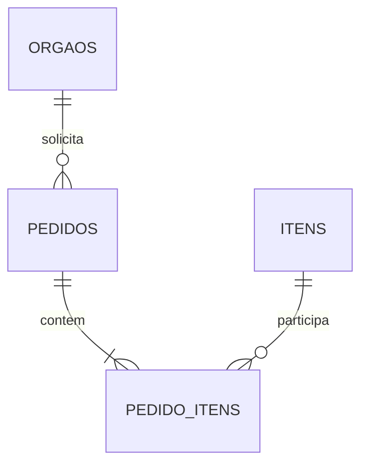

# Modelagem inicial

O modelo organiza órgãos, itens e pedidos conforme as relações e regras do enunciado. O ZIP já foi analisado, mas a importação ainda não foi implementada. As migrações criam a estrutura vazia. O tratamento previsto para o legado e o destino dos registros não aproveitáveis estão descritos no [README](../README.md#tratamento-dos-dados-legados).



| Tabela | Identidade e campos principais |
| --- | --- |
| `orgaos` | Código único; sigla, nome e UF |
| `itens` | Código único; descrição, unidade, saldo inicial e atual (`saldo`), ativo, versão e data de cadastro |
| `pedidos` | ID interno; identificador externo único, órgão, solicitante, origem, assinatura, situação, datas e motivo de cancelamento |
| `pedido_itens` | Chave composta de pedido e item; quantidade |

Quantidades usam `NUMERIC(19,3)` para cálculos decimais exatos. Datas usam `TIMESTAMP WITH TIME ZONE`. Códigos de negócio são strings para preservar zeros à esquerda. O ID interno de pedidos é gerado pelo banco; o externo identifica a requisição, inclusive quando reenviada.

## Por que o banco foi organizado assim

PostgreSQL permite combinar transações, bloqueios de registros, chaves estrangeiras e restrições. Isso atende ao principal risco do sistema: duas requisições consumirem o mesmo saldo ou um pedido ser gravado pela metade. O banco oferece os mecanismos; os serviços precisam utilizá-los corretamente.

As quatro tabelas separam informações com responsabilidades diferentes:

| Decisão | Motivo |
| --- | --- |
| `orgaos` separado de `pedidos` | Um órgão faz vários pedidos. Seu nome e sua UF são cadastrados uma vez, evitando cópias divergentes em cada pedido. |
| `itens` como catálogo único | Descrição, unidade, situação e saldo pertencem ao item, que pode aparecer em muitos pedidos. |
| `pedidos` como cabeçalho | Órgão, solicitante, origem e situação descrevem o pedido inteiro, não cada produto solicitado. |
| `pedido_itens` como associação | Um pedido contém vários itens e um item aparece em vários pedidos. A quantidade pertence a essa relação. |
| Chave composta em `pedido_itens` | Impede duas linhas do mesmo item no mesmo pedido. Pares repetidos no legado exigem tratamento antes da carga. |

Por exemplo, um pedido com papel e caneta gera um cabeçalho em `pedidos` e duas linhas em `pedido_itens`. Se não houver saldo para a caneta, o serviço deve desfazer toda a transação, inclusive o débito do papel.

O saldo atual fica em `itens` para permitir consulta e reserva sem recalcular milhões de linhas históricas a cada operação. O saldo inicial é preservado como referência de origem. Manter o saldo atual armazenado exige que débitos e devoluções sejam transacionais e que a importação seja reconciliada; a existência dessas colunas não garante essa consistência sozinha. Um livro de movimentações para auditar ajustes manuais é uma evolução ainda não implementada.

`versao` permite detectar edição desatualizada: o serviço deve atualizar o item apenas se a versão enviada ainda for a atual. `ativo` permite desabilitar novos pedidos sem apagar referências históricas. Não há exclusão em cascata porque excluir um cadastro não deve eliminar pedidos antigos.

O ID numérico interno torna as referências e os índices dos pedidos mais compactos que identificadores externos textuais. `id_externo` permanece único para reconhecer reenvios, e `assinatura` permite conferir se o conteúdo é o mesmo. Os códigos de órgãos e itens foram mantidos como chaves por já identificarem o legado; a premissa é que sejam estáveis e não editáveis.

`NUMERIC(19,3)` admite unidades fracionárias, como quilogramas e litros, sem os erros de representação de ponto flutuante. A escala de três casas é uma premissa da aplicação, não uma exigência do enunciado. Datas com fuso permitem guardar o instante de uma operação; como o legado não informa o fuso, a importação precisará adotar e documentar uma convenção.

## Integridade

As migrações impedem saldos negativos, quantidades não positivas, códigos duplicados, referências inexistentes e itens repetidos no mesmo pedido. Os campos textuais essenciais não podem ficar vazios. A versão do item começa em zero e não pode ser negativa.

Origem aceita `PORTAL` ou `INTEGRACAO`; situação aceita `CONFIRMADO` ou `CANCELADO`. Pedido confirmado não possui dados de cancelamento; pedido cancelado exige data igual ou posterior à criação e motivo preenchido. Chaves estrangeiras preservam as referências históricas, sem exclusão em cascata.

A obrigatoriedade de motivo e a consistência cronológica do cancelamento são premissas desta modelagem. O enunciado exige cancelamento único e devolução de saldo, mas não determina esses detalhes. A análise encontrou cancelamentos incompletos no legado; esses registros precisam de uma política explícita de tratamento antes da carga.

As restrições SQL não garantem sozinhas que um pedido tenha pelo menos uma linha, que o saldo seja debitado atomicamente, que o cancelamento ocorra uma única vez ou que a versão seja conferida nas edições. O módulo `orders` implementa essas garantias com validações de domínio, transações, bloqueios e testes de concorrência. A assinatura compara o conteúdo de reenvios com o mesmo identificador externo.

## Consultas

`V1` cria tabelas e índices para unidade/saldo e órgão/período/situação. `V2` adiciona índices para paginação por ID em pedidos. A chave primária de `pedido_itens` permite buscar as linhas de cada pedido. A ordenação por ID representa ordem de inclusão, que pode diferir da data de pedidos históricos.

Índices para busca parcial por descrição e ajustes de planos de execução dependem das medições com a massa real. Não foi comprovado desempenho sobre o volume do enunciado.

## Validação

```sh
mvn -Dtest=SchemaIntegrationTest test
```

Os testes de esquema executam Flyway e verificam restrições com SQL direto em H2 no modo PostgreSQL. Cada teste tem rollback. A suíte independe das classes de negócio. Adicionalmente, `OrdersPostgresTest` executa as operações de pedidos e estoque no PostgreSQL 15 real, incluindo concorrência e rollback. A carga histórica e seu desempenho ainda precisam de validação própria.

## Uso de IA nesta etapa

O Codex estruturou as migrações, revisou as restrições, escreveu testes SQL e analisou a massa histórica. As decisões e limitações estão documentadas para revisão pelo responsável pela entrega. A análise dos arquivos não equivale à implementação ou execução da carga.
